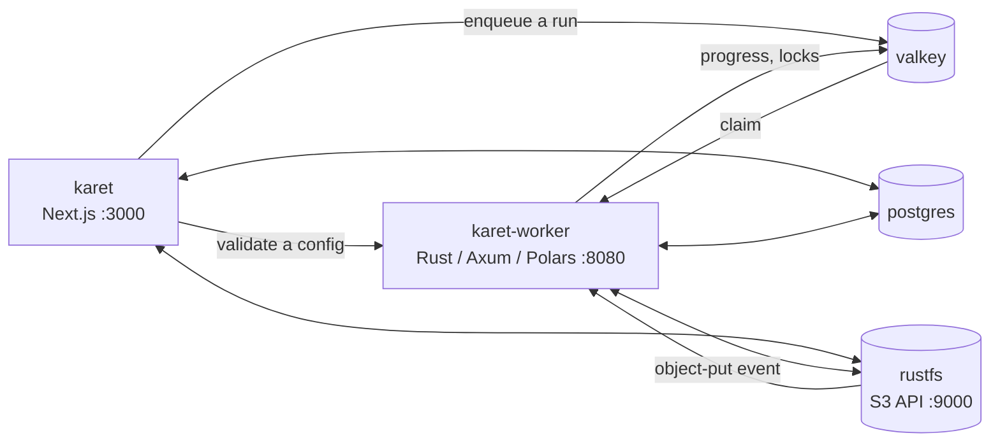

# Architecture

Karet is a web app, a worker, and the three stores they share, orchestrated by
Docker Compose. Postgres holds the control plane, three S3 buckets hold the data,
and Valkey coordinates the job queue.

| Service | Stack | Role |
|---------|-------|------|
| **rustfs** | [RustFS](https://rustfs.com) | S3-compatible object store. Hosts the three Karet buckets and posts upload events to the worker, which routes each event to every pipeline whose source prefix matches the uploaded key. |
| **valkey** | [Valkey](https://valkey.io) | Job queue (Redis stream), live job state, and webhook debounce. Coordination only. Losing it never loses history. |
| **postgres** | Postgres 17 | The control plane: accounts and sessions, the pipeline registry, config versions and job history. The web owns its schema; the worker reads configs and writes job rows. |
| **karet-worker** | Rust / Axum / Polars | Consumes jobs from the queue, ingests CSV and NDJSON sources, applies AST-JSON mapping expressions via Polars, writes partitioned Parquet, and owns the job lifecycle end to end. |
| **karet** | Next.js / React Flow / Chart.js | Renders the UI (pipeline list, graph editor, jobs, data, dashboards), queries the warehouse with DuckDB, enqueues manual runs, and owns auth. |

The diagram shows which service calls which. The table after it shows which
service writes to each store.



The web is the only service a browser reaches. The worker is reachable only on the
compose network, and the two speak just once: a config is validated by the worker
before the web publishes it. Everything else between them goes through a store.

## Who writes what

| Store | Holds | Written by | Read by |
|-------|-------|-----------|---------|
| **postgres** | accounts, sessions, pipeline registry, config versions, job rows; the DuckLake catalog in the `karet_lake` database | web (everything but job rows and the catalog, and it owns migrations), worker (job rows, the catalog) | both; the web reads the catalog as the read-only `karet_lake_reader` role |
| **valkey** | job stream, live job state, per-pipeline run locks, upload debounce | web (enqueue), worker (claim, progress, locks, its own debounced enqueues) | both |
| **karet-lake** | raw CSV and NDJSON you upload | web (the Data lake browser uploads, moves, deletes) | worker |
| **karet-warehouse** | the Parquet files of the DuckLake tables, under `lake/` | worker | both |
| **karet-pipelines** | dashboard YAML, saved queries, thumbnails, workspace settings | web | web |

In Postgres each table has exactly one writer. Only the worker writes the
analytic tables: a restore from the web goes to the worker, which takes the same
per-pipeline lock as a run.

## The job queue

Jobs travel over a Redis stream (`karet:jobs:stream`), never over HTTP:

1. **Enqueue.** A manual run (web) or a debounced upload event (worker)
   adds a message to the stream and creates a live-state hash
   (`karet:jobs:live:<id>`) with `status: queued`.
2. **Claim.** A worker claims the message via a consumer group, takes a
   per-pipeline lock (`SET NX` with heartbeat renewal) so at most one
   run per pipeline executes cluster-wide, and marks the job `running`.
3. **Execute.** The config is validated, source files ingested, and progress
   (stage, file/mapping counters) written to the live hash. Each write is
   announced on `karet:jobs:events:<pipeline>`, which the Jobs page follows
   through a server-sent event stream.
4. **Finish.** The worker updates the job's row in Postgres with its outcome,
   updates the live hash (24 h TTL), releases the lock, and acks the
   message.

Failures retry with exponential backoff (up to `MAX_ATTEMPTS`, default
3). If a worker crashes mid-run, its unacked message idles in the
pending-entries list until another worker reclaims and re-runs it.
A run that dies before publishing leaves the table on its previous
version, and running the same job twice produces the same table, so
at-least-once delivery is safe.

**Division of state:** Valkey holds coordination data (queue, live
status, debounce timers) that is small and can be lost; Postgres holds
job history. A Valkey crash loses at most about 1 second of coordination
writes (AOF `everysec`): a job that was queued but not started, never a
job record.

## The three buckets

Splitting by data class lets you set different lifecycle, access, and cost
policies per bucket.

| Bucket | Env var | Holds |
|--------|---------|-------|
| `karet-pipelines` | `S3_BUCKET_PIPELINES` | Dashboards, saved queries, thumbnails, workspace settings. |
| `karet-lake` | `S3_BUCKET_LAKE` | Raw source files you upload: CSV, or JSON lines. |
| `karet-warehouse` | `S3_BUCKET_WAREHOUSE` | Query-ready partitioned Parquet. |

## Design notes

- **Durable state is in Postgres and S3.** Back up both; see
  [backups](./data-stores#backups). Valkey holds only coordination state:
  keep its volume, but losing it costs queued jobs, not data.
- **The worker owns the job lifecycle**, including the webhook receiver
  for RustFS upload events and every job-record write. The web service
  only enqueues and reads.
- **The admin credential lives in the environment**
  (`KARET_ADMIN_PASSWORD_HASH`), not in a bucket. See
  [Authentication](./authentication).

## What lives where in S3

Each bucket keys objects under `pipelines/<slug>/`, so a pipeline's data
lines up across the three buckets:

```
karet-pipelines  pipelines/<slug>/dashboards/*.yaml       # one per dashboard
                 pipelines/<slug>/queries/*.json          # one per saved query
                 pipelines/<slug>/preview.png             # home-page thumbnail

karet-lake       pipelines/<slug>/transactions/*.csv     # raw inputs you upload

karet-warehouse  lake/<slug>/<table>/...parquet           # DuckLake data files
```

The config itself, the pipeline registry, job history and the table catalog are
rows in Postgres, not objects here. See [where data lives](./data-stores).

## Trust boundaries

- The web service binds publicly (port 3000 on the host). Its
  unauthenticated surface is `/login` and `/api/auth/*` only, and the
  login endpoint is rate-limited.
- The worker is reachable only over the compose network. Its
  `POST /config/validate` requires a bearer token
  (`KARET_WORKER_TOKEN`); `POST /events/s3` requires the webhook secret;
  `/health` is open for probes.
- Valkey is on an internal network reachable only by the web and worker
  services. Access to it is access to the job queue, so don't put it on
  a shared network.
- RustFS is exposed for local dev convenience but doesn't need to be.
- Job execution has no HTTP trigger. Only things that can write to the
  Redis stream can start a run.

See [Authentication](./authentication) for the admin password flow and
session cookies.
